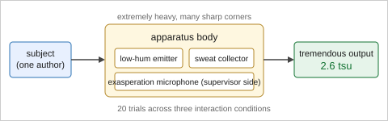
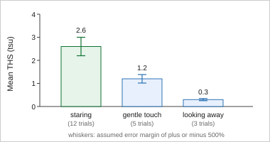

<!--
data/dummy/abe-lint/main.md — ABE の規定チェックの受入フィクスチャ【不適合原稿】

data/dummy/abe/main.md (適合原稿) の対になるダミー。**わざと ABE の規定に違反させてある**ので、validate.py の
ABE の検査が期待どおり発火することを機械で確かめられる。

  docker compose -f docker/docker-compose.yml run --rm -u "$(id -u):$(id -g)" pandoc \
      python3 main/step05_package/validate.py \
          --input-root data/dummy/abe-lint --journal abe --article-type original

【内容は明らかなフィクション】適合原稿と同じ TJD/THS の物語。実在の人名・所属は使わない。
  違反の型は、規定の要求と学会テンプレートの見本の形 (所属の記号・姓の書き方など) から採った。

【期待される指摘】要修正 12 件 / 参考 15 件 (下の番号は出力の順ではない)。
  指摘ごとの文面は main/step05_package/test_validate_abe.py が照合する

【仕込んである違反】(→ は区分)
   1. 抄録が 350 語を超える (406 語)                                       → 要修正 (limits.abstract_words)
   2. 抄録が 2 段落 (助言は 1 段落の文章にまとめる形)                      → 要修正 (abstract.single_paragraph)
   3. 抄録に文献引用 [@yokan2099]                                          → 要修正 (abstract.citations_allowed)
   4. キーワードが 6 語 (規定は 5 語まで)                                  → 要修正 (limits.keywords)
   5. キーワード hunch が題の語を繰り返す                                  → 要修正 (lint.keywords_not_in_title)
   6. running title が 50 字を超える (63 字)                               → 要修正 (limits.running_title_chars)
   7. 著者 Taro Yokan と Bonta Dan の姓が大文字でない (Bonta Dan は強制改行の後)
                                                                           → 要修正 (lint.author_surname_caps)
   8. Results と Discussion の節が無い (結果の節は Resultant observations。語の境界で照合するので Results と見なさない)
                                                                           → 要修正 (sections.required)
      ※ 方法の節は Methods、利益相反の節は Conflicts of interests と書いてある。どちらも言い換え・単複の揺れとして
        通ること (要修正に出ないこと) を兼ねて確かめる。Introduction は setext の見出し (下線の ====) で書いてあり、
        欠落に出ないこと も確かめる
   9. 題の無い図 1 点と題の無い表 2 点 (pipe table と simple table。1 件にまとめて出る。simple table は表の点数にも入る)
                                                                           → 要修正 (lint.float_titles)
  10. 記入欄 `<<...>>` が 1 箇所残っている                                 → 要修正 (lint.placeholder_markers。基底の検査)
  11. 抄録が見出しつきの構造化抄録 (**Background:** / **Results:**)
                                                                           → 要修正 (lint.unstructured_abstract)
  12. 表の題に {#tbl:supervisors .wide} と書いた (pandoc-crossref が番号を付けられない)
                                                                           → 要修正 (lint.table_caption_attrs)
   a. 抄録が図表に触れている (Fig. 1 と Supplementary Fig. S1)
                                                                           → 参考 (abstract.floats_allowed)
   b. 機関が 2 つなのに所属を記号 ^*^ ^**^ で対応づけている (テンプレートの見本の形)
                                                                           → 参考 2 件 (所属と著者。lint.affiliation_superscript)
   c. 利益相反の節が規定の定型文でなく "The authors declare no conflicts of interest regarding the support of this study."
      (否定した support を申告と見なさない)            → 参考 (lint.coi_section)
   d. participants (人を扱うらしい語) があるのに Ethics declaration の節が無い → 参考 (lint.ethics_section)
   e. AI ツール (ChatGPT) の使用を Acknowledgements にだけ書いている (ABE の規定は Materials and methods)
                                                                           → 参考 (lint.ai_disclosure_section)
   f. 引けない文献 (@unpublished と、note が personal communication の @misc)
                                                                           → 参考 (lint.uncitable_references)
   g. 図の題が Title Case (Mean Score by Interaction Condition)            → 参考 (lint.caption_minimal_caps)
   h. 題に略語 (TJD) とシリーズ番号 (Part II)                              → 参考 2 件 (lint.title_conventions)
   i. Acknowledgements に資金を書いたが助成番号が無い (fund / grant の語を使わず "supported by … Foundation" だけで書いた)
                                                                           → 参考 (lint.funding_section)
   j. 略語 THS を本文の初出で定義していない                                → 参考 (lint.abbreviation_definitions)
   k. 著者名に学位 PhD (姓の大文字の検査では除き、著者も増やさない)
                                                                           → 参考 (lint.author_surname_caps)
   l. 抄録に手で書いた番号の引用 [2]                     → 参考 (abstract.citations_allowed)
   m. 補足資料にアーカイブ supplementary/analysis-code.tgz
                                                                           → 参考 (lint.supplementary_archives)

【仕込んでいない違反】(別の入力で確かめる)
  - **本文語数の超過** (Original Paper 4 000 語): 4 000 語の散文は維持費に見合わない。適合原稿 data/dummy/abe を
    --article-type technical (1 500 語) で回すと出る。
  - **running title が無い** (題が 50 字超)・**資金が節の外**・**AI の開示が無い**: 上の 6・i・e と同時には起こせないので、
    変種 variants/run-funding-ai/ に置いた。
  - **表題ページの Div の欠落と重複** (lint.front_matter_divs): ほかの検査が Div を読めなくなるので、変種 variants/missing-divs/ に置いた
  - **補足資料の容量** (1 ファイル 50 MB・合計 50 MB): 50 MB のファイルは git に置かない。supplementary/ の数百バイトのファイルを、
    test_validate_abe.py の中だけで上限を数百バイトに下げた profile で検査する。
    アーカイブは m の .tgz で発火させる (検査は .zip・.tar.gz・.tgz などのアーカイブの拡張子を同じに扱う)。
  - **reference.docx に無い custom-style** (参考): 指摘が reference.docx (git で追跡しない生成物) の有無で変わるので、
    件数を固定するフィクスチャには入れない。

【注意】本ファイルは **lint を発火させるための原稿**である。ビルドは通るが (図と ref.bib を同梱してある)、
  成果物を提出物の見本として読まないこと。適合原稿の見本は data/dummy/abe/。
-->

::: {custom-style="Title"}
TJD Measurement of the Tremendous Hunch, Part II
:::

<!-- 違反 7 (姓) と b (所属の記号): 学会テンプレートの見本と同じ形。
     3 人目は強制改行 (行末の \) で並べ (改行でも著者を割ること)、学位 PhD を添えた (k。学位を姓と見なさず、
     著者を 1 人増やさないこと) -->
::: {custom-style="Author"}
Taro Yokan^\*^, Hanako CHOKKAN, PhD^\*\*^\
Bonta Dan^\*^
:::

::: {custom-style="Affiliation"}
^\*^Graduate School of Hunch Engineering, University of the Tremendous, Tremendo, Hunchshire, Fictionia

^\*\*^Department of Intuition Informatics, Vibes Research Institute, Vibeston, Hunchshire, Fictionia
:::

<!-- 違反 6: running title が 50 字を超える -->
::: {custom-style="Subtitle"}
Measuring the tremendous hunch with a heavy apparatus, part two
:::

::: {custom-style="Normal"}
Received ………….. [Do not enter]

Revised ………….. [Do not enter]
:::

# Abstract {.unnumbered}

<!-- 違反 1・2・3・a: 406 語・2 段落・文献引用・図への言及。
     2 つの段落を見出し (**Background:** / **Results:**) で始め (違反 11 = 構造化抄録)、
     補足資料の図 (Supplementary Fig. S1。a に入る) と手で書いた番号の引用 [2] (l) を足した -->
::: {custom-style="Abstract"}
**Background:** The tremendous hunch felt on waking is widely reported, yet it has never been measured, because no
instrument records it and no scale expresses it [@yokan2099]. A measurement would let laboratories
compare hunches instead of merely reporting them, and would show whether the circumstances in which a
hunch is reported can be separated from the hunch itself. In the first part of this series we built a
heavy apparatus and defined a dimensional scale. In this second part we ask whether the ordering of
three interaction conditions survives when the apparatus is operated by a different laboratory, by a
different supervisor, and on a different set of mornings. The apparatus logs three quantities during
each trial: the intensity of the hunch reported by the subject, the volume of cold sweat collected
from the forearm, and the degree of exasperation shown by the supervising professor. We kept the
scale exactly as it was defined in the first part, and we fixed in advance that the ordering of
conditions, rather than the magnitude of the scores, would be the primary outcome of the replication.

**Results:** Two subjects performed 40 trials across the three predefined interaction conditions: staring, gentle
touch, and looking away (Supplementary Fig. S1), as in the first part [2]. The trials were spread over eight mornings so that no single morning's mood
could dominate the record, and the order of the conditions within each morning was chosen by the
subjects rather than by a schedule, as in the first part. Staring again produced the highest mean
score, followed by gentle touch and looking away, as shown in Fig. 1. The ordering held in 38 of the
40 trials, whereas the absolute scores moved by an order of magnitude between trials and between the
two laboratories, mainly because the exasperation of each supervisor was scored by a different human
listener. The two trials in which the ordering failed were both recorded on the same morning, on
which the apparatus had been moved to a colder room and the low hum on startup was noticeably
quieter. We conclude that the ordering of the three conditions is a property of the hunch and not of
the original laboratory, while the absolute magnitude of the tremendous hunch remains inconclusive.
Standardising the human-scored input remains the single step that would most improve the scale, and a
calibrated sigh detector is now being built for the third part of the series.
:::

<!-- 違反 4 (6 語) と 5 (hunch は題の語) -->
::: {custom-style="Keywords"}
**Keywords**: intuition, psychophysics, hunch, reproducibility, cold sweat, equipment design.
:::

<!-- setext の見出し (下線の ====)。見出しとして読み、Introduction の欠落を出さないこと -->

Introduction
============

The hunch that arrives on waking is reported often enough that it needs no defence as a phenomenon,
yet before the first part of this series it had never been measured [@yokan2099]. The Totetsumonai
Jikken Device (TJD) was built to convert the hunch into a physical quantity, and a dimensional scale was
defined from its three inputs. Informal testimony gathered at a drinking party had rated the study as
unprecedented [@chokkan2100], and a dimensional treatment of cold sweat had been suggested in
conversation [@dan2099].

<!-- 違反 8: 方法の節を Methods と書いた (言い換えとして通る)。Discussion の節は書いていない -->

# Methods

<!-- 違反 d (participants) と j (THS を定義せずに使う) -->

Two participants, the first and second authors, performed 40 trials with the TJD. The score on the
THS was computed for each trial from hunch intensity, cold-sweat volume, and the exasperation of the
supervising professor, exactly as defined in the first part.

<!-- 違反 9: 題の無い図 (alt が空) -->

{width=80mm}

The number of trials per condition followed the preference of each participant and was not randomised.

<!-- 違反 8: 結果の節の名前を Resultant observations にした。語の境界で照合するので Results とは見なさず、
     Discussion と並んで欠落に出る (文字列の前方一致で照合すると Results と見なしてしまう) -->

# Resultant observations

The ordering of the conditions held in 38 of the 40 trials ([@fig:ths]).

<!-- 違反 g: 題が Title Case -->

{#fig:ths width=80mm}

::: {custom-style="Legend" for="fig:ths"}
Bars show the mean score for each condition and whiskers show the assumed margin of plus or minus
500%, which is a convention and not a confidence interval.
:::

The trials in which the ordering failed are listed below.

<!-- 違反 9: 題の無い表 (前後に `: 題` の行が無い) -->

| Trial | Laboratory | Condition |
|------:|:-----------|:----------|
|    17 | second     | staring   |
|    18 | second     | staring   |

<!-- 違反 9: 題の無い simple table (パイプでない表)。上の表と同じ要修正に入り、表の点数にも数える -->

  Morning   Room temperature
  -------   ----------------
  6         cold
  7         warm

<!-- 違反 12: 表の題に .wide を書いた (pandoc-crossref が番号を付けられない。段抜きは ::: wide の Div で書く) -->

: Supervisors of the two laboratories. {#tbl:supervisors .wide}

| Laboratory | Supervisor        | Mornings |
|:-----------|:------------------|---------:|
| first      | supervisor A      |        4 |
| second     | supervisor B      |        4 |

# Conclusion

The ordering of the three conditions survived the replication. <<Describe the third part of the series>>

<!-- 違反 c: 規定の定型文ではない (節名は Conflicts of interests = テンプレートの綴り。単複の揺れとして通る)。
     否定した資金の語 (no … the support) を添えた。申告の語と見なさず、参考が出ること -->

# Conflicts of interests {.unnumbered}

The authors declare no conflicts of interest regarding the support of this study.

<!-- 違反 e (AI の開示を Methods ではなくここに書いた) と i (資金に助成番号が無い)。
     資金は fund / grant の語を使わず "supported by … Foundation" だけで書いた (資金の記述と見なすこと) -->

# Acknowledgements {.unnumbered}

The English of the manuscript was checked with ChatGPT. This work was supported by the Tremendous
Hunch Promotion Foundation.

# References {.unnumbered}

::: {#refs}
:::
