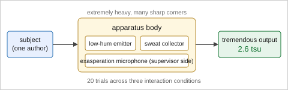
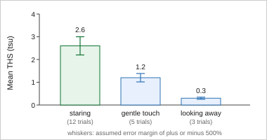

<!--
data/dummy/abe/main.md — ABE (Advanced Biomedical Engineering) の動作例

ABE の規定に【適合した】完結原稿で、build / diff / package / 規定チェックの動作を確かめる入力にもなる。
使うコマンドは【必ず --input data/dummy/abe を明示する】(入力ルートは .development の有無だけで data/dummy / src に決まる)。
骨格 data/journals/abe/skeleton/main.md の記入欄を埋めた形になっている (節と小節の並びが同じ)。定型の記述の文例は同じディレクトリの statements.md。

  bash scripts/build.sh --journal abe --article-type original --input data/dummy/abe
  bash scripts/build.sh --journal _default --input data/dummy/abe      # 原稿は雑誌非依存

【内容は明らかなフィクション (パロディ)】TJD/THS の物語 (出典は https://github.com/fk506cni/jami-pandoc-public) を
  ABE の形式で書いた。実在の人名・所属・メールは使わない。

【並び】(docs/journal-abe.md §3・§8.3。学会テンプレートの見本の並び)
  表題ブロック: Title → Author → Affiliation → Subtitle (running title) → Received / Revised → Abstract の見出し ({.unnumbered}) → Abstract → Keywords
  本文 (番号つき): Introduction → Materials and methods → Results → Discussion → Conclusion
  後ろの節 (番号なし。{.unnumbered}): Conflicts of interest → Ethics declaration → Acknowledgements → References
  - 表題ページの要素はすべて custom-style の Div で書く (YAML のメタデータは差分の対象にならないため。CLAUDE.md「原稿執筆の規約」)
  - 2 段組の指示は原稿に書かない (段組は誌のプロファイルと後処理の仕事)。段の幅 (83 mm) に収まらない図表は
    段抜き (本文幅) にする: 図は {.wide} を付け、表は ::: wide の Div で囲む (表の題の {#tbl:x} に .wide を足すと番号が付かない)。
    凡例 (Legend の Div) は図表の直後に置けば一緒に本文幅になる。段組の無い誌 (--journal _default) では何もしない
  - 見出しの番号は書かない (学会テンプレートの自動番号を使う)。番号なしの節は {.unnumbered} (profile の headings.unnumbered_style で
    NoNumberSectionHeader の段落になる)。Abstract の見出しも {.unnumbered} の見出しで書く (誌のスタイル名を原稿に書かない)
  - 式の参照は [@eq:x] だけを書く (Eq. [@eq:x] と書くと "Eq. Eq. 1" になる)

【規定への適合】(規定チェック (validate.py) で要修正 0・参考 0 になる。不適合の対は data/dummy/abe-lint/)
  - 姓はすべて大文字・所属は上付き数字 (異なる機関の著者がいるため)・題は 50 字を超えるので 50 字以内の running title を置く (§3.1)
  - 異動後の新住所は著者名の直後の脚注 (^[Present address: …]) に書く。docx では著者の脚注の参照と番号が記号 (* **) になり、
    本文の脚注は数字のまま (§3.1。profile の title_page.author_footnote_marks)
  - 抄録は 1 段落・350 語以内・引用なし・図表に触れない・略語を使わない。キーワードは 5 語で、題の語を繰り返さない (§3.1)
  - 略語は本文の初出で定義する (題と抄録での定義は本文の初出とみなさない。§3.2)
  - AI ツールの使用は Materials and methods の最後の小節で開示する (§3.2。誌によっては Acknowledgments に置くので、置き場所に注意)。非生成の綴りの確認ツールだけを
    使った形 (statements.md の §4 の (a))。非生成 AI の使用は投稿時に編集者へも申告するので、cover-letter.md にも 1 段落ある
  - データの入手先と公開は Materials and methods の末尾の小節 (規定は場所を決めていない。骨格の既定。statements.md の §0・§6)
  - 資金は Acknowledgements に資金提供者と助成番号の両方を書く (§3.3)。COI が無い場合は規定の定型文 (§3.3)
  - Ethics declaration は規定の例文 1 (ヘルシンキ宣言 + インフォームドコンセント) の形 (§3.3)
  - 図は Fig. 1 / Fig. 2、表は Table 1 で本文から引用順に参照する。題はセンテンスケース (§5)
-->

::: {custom-style="Title"}
Quantifying the Tremendous Hunch with a Purpose-Built Apparatus and a New Dimensional Scale
:::

::: {custom-style="Author"}
Taro YOKAN^1^, Hanako CHOKKAN^2^^[Present address: Department of Gut Feeling, Hunch Institute of Technology, Gutsby, Fictionia.], Bonta DAN^1^
:::

::: {custom-style="Affiliation"}
^1^Graduate School of Hunch Engineering, University of the Tremendous, Tremendo, Hunchshire, Fictionia

^2^Department of Intuition Informatics, Vibes Research Institute, Vibeston, Hunchshire, Fictionia
:::

<!-- running title (規定: 題が空白込みで 50 字を超えるなら所属の後に 50 字以内で置く)。題は 91 字、running title は 32 字。
     学会テンプレートの「abbreviated title」の位置とスタイル (Subtitle) に置き、柱にも使う -->
::: {custom-style="Subtitle"}
Quantifying the tremendous hunch
:::

<!-- 受付日と改訂日は編集部が記入する欄で、学会テンプレートの見本の文面のまま残す ([Do not enter])。
     本文の語数には入らない (validate の META_STYLES) -->
::: {custom-style="Normal"}
Received ………….. [Do not enter]

Revised ………….. [Do not enter]
:::

# Abstract {.unnumbered}

::: {custom-style="Abstract"}
The tremendous hunch felt on waking is widely reported, yet it has never been measured, because no
instrument records it and no scale expresses it. A measurement would let laboratories compare hunches
instead of merely reporting them, and would show whether the circumstances in which a hunch is
reported can be separated from the hunch itself. We built a purpose-built apparatus that logs three
quantities during each trial: the intensity of the hunch reported by the subject, the volume of cold
sweat collected from the forearm, and the degree of exasperation shown by the supervising professor.
From these three quantities we defined a dimensional scale, whose unit we call the tremendous scale
unit, and we fixed in advance that the ordering of conditions, rather than the magnitude of the
scores, would be the primary outcome. To our knowledge, this is the first instrument and the first
scale proposed for the hunch. A single subject performed 20 trials across three predefined
interaction conditions: staring, gentle touch, and looking away. Staring produced the highest mean
score, at 2.6 units, followed by gentle touch at 1.2 and looking away at 0.3. The ordering held in
every one of the 20 trials, whereas the absolute scores moved by an order of magnitude between
trials, mainly because the exasperation of the supervisor was scored by a human listener. The
apparatus and the scale together yield a reproducible ordering of the three conditions, while the
absolute magnitude of the tremendous hunch remains inconclusive; standardising the human-scored
input is the step that would most improve the scale.
:::

::: {custom-style="Keywords"}
**Keywords**: intuition, psychophysics, equipment design, reproducibility, cold sweat.
:::

# Introduction

The hunch that arrives on waking — "this is a research project with a tremendous hunch" — is
reported often enough that it needs no defence as a phenomenon, yet it has never been
measured [@yokan2099]. Conventional research proceeds from a hypothesis; the present work proceeds
solely from a hunch, which we consider groundbreaking.^[In this paper a hunch is any conviction that
precedes its evidence by at least one night of sleep. The definition is deliberately operational and
makes no claim about whether the hunch is correct.]

Despite the ubiquity of the experience, no instrument or scale has been described for measuring a
hunch. The prior accounts we could find are limited to informal testimony gathered at a drinking
party, where respondents rated the study as unprecedented and the first author as possibly
overtired [@chokkan2100]. A dimensional treatment of the accompanying cold sweat has been proposed,
but it stops short of an instrument [@dan2099]. None of these accounts [@yokan2099; @chokkan2100;
@dan2099] separates the hunch from the circumstances in which it is reported, and none offers a
quantity that two laboratories could compare.

We therefore built an apparatus and defined a scale, and asked two questions: whether the scale
orders three interaction conditions consistently, and whether that ordering survives the error
introduced by the least controllable of its three input quantities. The second question matters
more than the first, because an ordering that collapses under honest error bars would be a property
of the analysis rather than of the hunch.

# Materials and methods

## Study design and subject

This was a descriptive, single-subject study. The sole subject, the first author, performed 20
trials across three predefined interaction conditions with the apparatus: staring, gentle touch, and
looking away. Each trial lasted until the subject declared that the hunch had either peaked or gone,
and the operator recorded the declared end without questioning it. Trials were spread over four
mornings so that no single morning's mood could dominate the record.

The order of the conditions within a morning was chosen by the subject rather than by a schedule. We
kept this choice, against our own first instinct, because the subject reported that an imposed order
made the hunch feel administrative, and an administrative hunch is not the phenomenon we set out to
measure. The consequence for the balance of the conditions is discussed in the Discussion.

## The apparatus

To convert the hunch into a physical quantity we built the Totetsumonai Jikken Device (TJD), shown in
[@fig:apparatus]. The device is extremely heavy and has many sharp corners, so its merits are
difficult to argue using ordinary indicators such as portability or safety. On startup it emits a
low hum and renders the surrounding air vaguely oppressive. The body of the device carries three
sensors, each feeding one of the three input quantities of the scale.

{#fig:apparatus .wide}

::: {custom-style="Legend" for="fig:apparatus"}
Rectangles denote components and arrows denote the direction of measurement. The subject sits at the
left, the apparatus body carries the three sensors, and the output display at the right shows the
score for the current trial in tremendous scale units (tsu). The low-hum emitter is not a sensor; it is
retained because removing it lowered the reported hunch intensity in pilot runs.
:::

### Sensor layout

The hunch-intensity sensor is a dial that the subject turns while the hunch is present; the dial has
no markings, so that the subject cannot anchor on a remembered value. The cold-sweat sensor is a set
of collection vials held at 4 °C against the subject's forearm. The exasperation sensor is a
microphone on the far side of the bench, pointed at the supervising professor, whose sighs are scored
by a listener in a separate room.

The three sensors were sampled at the same rate and written to a single log. Because the dial and the
vials are read automatically while the sighs are scored by a person, the log mixes two kinds of
quantity, and we kept a flag on every sample to say which kind it was. This flag later turned out to
be the most useful column in the log.

### Collection vials

The vials were weighed before and after each trial on an analytical balance (HB-0000, Fictional Scales,
Tremendo, Fictionia) that reads to a tenth of a milligram, and the difference was converted to a volume
assuming the density of water. The conversion is not exact, since sweat is not water, but the error it
introduces is small compared with the error in the third quantity, and we did not correct for it.

## The scale

The International System of Units cannot describe the tremendousness of this study. We therefore
defined the Totetsumonai Hyouka Scale (THS) from hunch intensity $P$, cold-sweat volume $S$, and the
supervisor's degree of exasperation $A$, as

$$ \mathrm{THS} = \frac{P \times S}{A^{2}} $$ {#eq:ths}

The unit is the tremendous scale unit (tsu). Placing exasperation in the denominator, and squaring
it, is deliberate: a supervisor who is entirely unmoved makes any hunch look tremendous, and we wanted
that property to be visible in the formula rather than buried in the discussion. Because the
exasperation term is the least stable of the three, we carried a fixed proportional margin on every
score,

$$ \sigma_{\mathrm{THS}} = 5 \times \mathrm{THS} $$ {#eq:err}

which corresponds to the margin of plus or minus 500% used throughout. The score is defined by
[@eq:ths] and its margin by [@eq:err]; the margin is a convention, not a confidence interval.

## Outcome measures and analysis

For each condition we aggregated the number of trials and computed the mean THS. Continuous
quantities are reported as medians with interquartile ranges (IQRs). Because the measurement of
exasperation is inherently unstable, conditions were compared by their mean ordering rather than by
formal significance testing. The apparatus logged 12 000 samples over the 20 trials.

We decided before the first trial that the ordering, not the magnitude, would be the primary outcome.
This decision was written on the whiteboard in the laboratory and photographed, which is the closest
thing the study has to a registered protocol. The secondary outcome was the share of the propagated
error that came from each of the three inputs.

<!-- 規定が置き場所を決めていないデータの記述は、骨格と同じく Materials and methods の末尾の小節に置いた
     (data/journals/abe/skeleton/statements.md の §0・§6)。規定はデータを査読中に編集者と査読者へ全量開示し、出版日までに公開するよう求める
     (J-STAGE Data は規定が推奨する公開先。投稿の時点では DOI が無いので「公開する」と書き、受理後に DOI の形に直す) -->

## Availability of data and materials

The sample log of all 20 trials, including the flag that marks each sample as read automatically or
scored by the listener, will be made publicly available in J-STAGE Data by the date of publication.
During peer review, the complete log is available to the editors and reviewers through the submission
system. The analytical balance is commercially available from the manufacturer named above.

## Use of artificial intelligence tools

No generative artificial intelligence (AI) tool was used in this study. The authors used SpellHunch
(version 0.0, Vibes Research Institute, Vibeston, Fictionia), a non-generative AI tool, only to check
the spelling and grammar of the manuscript. The tool was not used to collect or analyse data, to
produce or amend figures, or to write any part of the text, and the authors take full responsibility
for the entire content of the manuscript.

# Results

## Trials and conditions

All 20 planned trials were completed and none was excluded. Staring accounted for 12 trials, gentle
touch for 5, and looking away for 3; the imbalance follows the subject's own preference and was not
randomised. The mean score for each condition is given in [@tbl:conditions].

: Mean score for each of the three interaction conditions. {#tbl:conditions}

| Condition     | Trials | Mean THS (tsu) |
|:--------------|-------:|---------------:|
| Staring       |     12 |            2.6 |
| Gentle touch  |      5 |            1.2 |
| Looking away  |      3 |            0.3 |

::: {custom-style="Legend" for="tbl:conditions"}
Values are arithmetic means over the trials in each condition and carry the assumed margin of plus or
minus 500%. The three conditions are mutually exclusive and together account for all 20 trials. THS,
Totetsumonai Hyouka Scale; tsu, tremendous scale unit.
:::

## Scores by condition

Staring yielded the highest score, consistent with the intuition that one should look directly at the
target to heighten a hunch ([@fig:ths]). Gentle touch came second by a wide margin, and looking away
scored close to zero, which is what one would expect if the hunch requires at least some attention to
be paid to its object. The subject's own ranking of the conditions, collected after the last trial,
matched the measured ordering.

{#fig:ths}

::: {custom-style="Legend" for="fig:ths"}
Bars show the mean score for each condition and whiskers show the assumed margin of plus or minus
500%, which is a convention and not a confidence interval. Condition labels carry the number of trials
contributing to each bar. THS, Totetsumonai Hyouka Scale; tsu, tremendous scale unit.
:::

## Stability of the ordering

The ordering staring > gentle touch > looking away held in every one of the 20 trials, whereas the
absolute values did not. The IQR of the exasperation term spanned an order of magnitude and dominated
the propagated error. Cold-sweat volume was the only one of the three inputs that the apparatus
recorded without operator intervention; hunch intensity was self-reported and exasperation was scored
by a listener.

The inputs and scores of the first eight trials are listed in [@tbl:trials]. The lower and upper
bounds are the score minus and plus five times the score, from [@eq:err]; negative lower bounds are
kept as computed, because they show that the margin is a convention and not a physical range.

<!-- 段抜きの表 (9 列。段の幅 83 mm には収まらず、段に置くと Word が数字をセルの中で折り返す)。表は ::: wide の Div で囲む -->

::: wide
: Inputs and scores of the first eight trials. {#tbl:trials}

| Trial |      P |      S |      A |    THS |     Low |   High |   Time |   Temp |
|------:|-------:|-------:|-------:|-------:|--------:|-------:|-------:|-------:|
|     1 | 81.250 | 12.875 | 19.375 | 2.7865 | -11.149 | 16.722 | 184.25 | 21.375 |
|     2 | 77.500 | 11.625 | 18.750 | 2.5627 | -10.251 | 15.376 | 171.50 | 21.250 |
|     3 | 42.125 | 10.500 | 20.125 | 1.0921 | -4.3684 | 6.5526 | 139.75 | 21.500 |
|     4 | 80.375 | 13.250 | 20.000 | 2.6624 | -10.650 | 15.974 | 190.00 | 21.625 |
|     5 | 12.750 | 9.8750 | 21.250 | 0.2788 | -1.1152 | 1.6728 | 98.250 | 21.125 |
|     6 | 79.625 | 12.500 | 19.125 | 2.7212 | -10.885 | 16.327 | 176.75 | 21.375 |
|     7 | 45.875 | 11.000 | 19.875 | 1.2775 | -5.1100 | 7.6650 | 142.00 | 21.250 |
|     8 | 13.500 | 10.125 | 20.500 | 0.3253 | -1.3012 | 1.9518 | 101.50 | 21.500 |
:::

::: {custom-style="Legend" for="tbl:trials"}
P, hunch intensity read from the unmarked dial (arbitrary units); S, cold-sweat volume (µL); A,
exasperation score; THS, Totetsumonai Hyouka Scale (tsu); Low and High, the score minus and plus five
times the score (tsu); Time, duration of the trial (s); Temp, room temperature (°C).
:::

We repeated the comparison after removing, in turn, each of the three inputs from the score. With
exasperation removed, the ordering still held in all trials, and the spread of the scores fell by more
than half. With hunch intensity removed, the ordering held in 18 of the 20 trials. With cold-sweat
volume removed, it held in 19. The ordering is therefore carried mainly by the self-reported
intensity, supported by the sweat, and only blurred by the exasperation.

## Additional observations

The low hum emitted by the apparatus on startup was not part of the design. It is produced by a
transformer that we could not replace without rebuilding the frame. In three pilot trials run with the
transformer disconnected, the subject reported a lower hunch intensity than in any of the main trials,
and we decided to keep the hum rather than explain its absence. We record the decision here because a
second apparatus built from our description would otherwise hum or not by accident.

The supervising professor was not told the purpose of the microphone until after the last trial. When
told, the professor's exasperation, as scored by the same listener, rose to a level that would have
pushed every score below 0.1 tsu. We did not include this reading in the analysis, but it illustrates
how strongly the third input depends on circumstances outside the apparatus.

# Discussion

The results place staring at the top of the ordering, which agrees with the informal testimony
collected earlier [@chokkan2100] and with the directness intuition that motivated the study. The
finding that matters, however, is not the ordering itself but its stability: the ordering survived in
all 20 trials while the absolute scores moved by an order of magnitude between them. A scale can be
useful for ranking long before it is useful for measurement.

The dominant source of error was not the apparatus but the third input. Exasperation was scored by a
listener, and squaring it in the denominator amplifies whatever noise that scoring carries.
Standardising this term — a calibrated sigh detector is the obvious candidate — would do more for the
scale than any improvement to the sensors, and the same argument applies to any composite index that
mixes instrumented and human-scored quantities [@dan2099].

It is tempting to drop the exasperation term altogether, since the ordering survives without it and
the spread falls. We resisted this for two reasons. First, the term was part of the scale as defined
before the first trial, and removing it after seeing the data would turn a measurement into a fit.
Second, the term is the only one of the three that carries information about the setting in which the
hunch is reported, and a scale that ignores the setting would describe the subject rather than the
hunch.

This study has three limitations. It used a single subject, who is also the first author and knew the
hypothesis, so the agreement between the measured ordering and the subject's own ranking may say more
about the subject's consistency than about the scale's validity. The number of trials per condition
follows the subject's preference rather than a randomisation schedule, so the conditions are not
balanced. Finally, we evaluated the ordering, not any downstream consequence of knowing it, which is
what would ultimately justify building a second apparatus.

# Conclusion

The apparatus and the scale together produced a reproducible ordering of three interaction
conditions — staring at 2.6, gentle touch at 1.2, and looking away at 0.3 tsu — that held in every
trial. The absolute magnitude of the tremendous hunch remains inconclusive. Standardising the
exasperation term is the most promising next step.

<!-- ここから番号なしの節 (学会テンプレートの NoNumberSectionHeader の段落になる。profile の headings.unnumbered_style)。
     節名の綴りは規定の中でも揺れる (Conflicts of interest / interests、Acknowledgments / Acknowledgements)。
     本動作例は英式で書いてある (randomised / labelled / Standardising) ので Acknowledgements にした (docs/journal-abe.md §9 の 6) -->

# Conflicts of interest {.unnumbered}

The authors declare no conflicts of interest with any companies or commercial organizations per the
definition of Japanese Society for Medical and Biological Engineering.

<!-- 規定の例文 1 の形。承認した委員会と番号は架空 (倫理審査の証拠書類は原稿とともに出す。<INPUT_ROOT>/forms/ に置けば提出パッケージに入る) -->

# Ethics declaration {.unnumbered}

This study was conducted in accordance with the ethical principles of the Helsinki Declaration, and
after obtaining informed consent from the subject. The study was approved by the Ethics Committee of
the University of the Tremendous (approval number TREM-0000).

<!-- 資金は資金提供者と助成番号の両方を書く (規定)。財団名と番号は架空 -->

# Acknowledgements {.unnumbered}

We thank Mushi Shirase for calibrating the sigh detector, a contribution that does not meet the
criteria for authorship. This work was supported by the Tremendous Hunch Promotion Foundation (grant
number THPF-0000).

# References {.unnumbered}

::: {#refs}
:::
